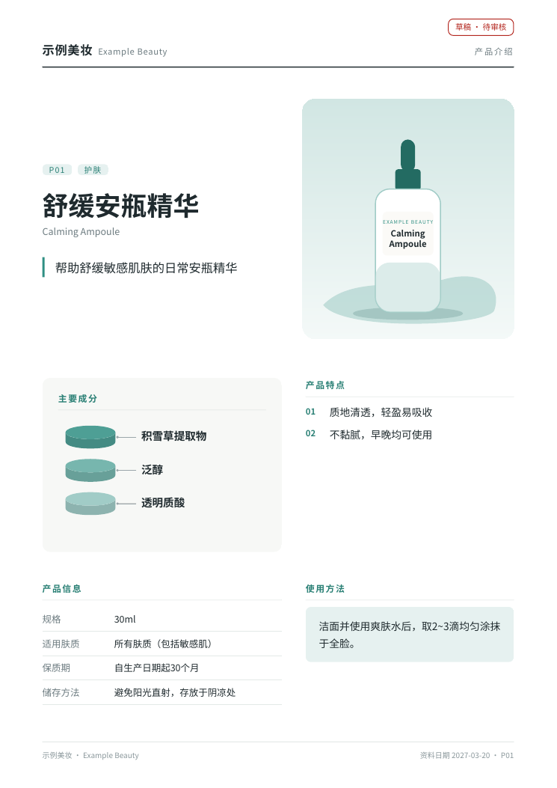
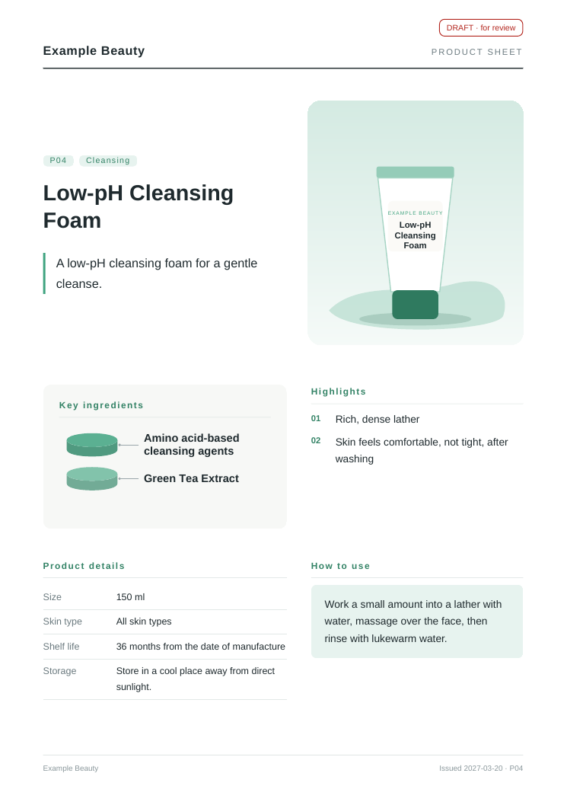
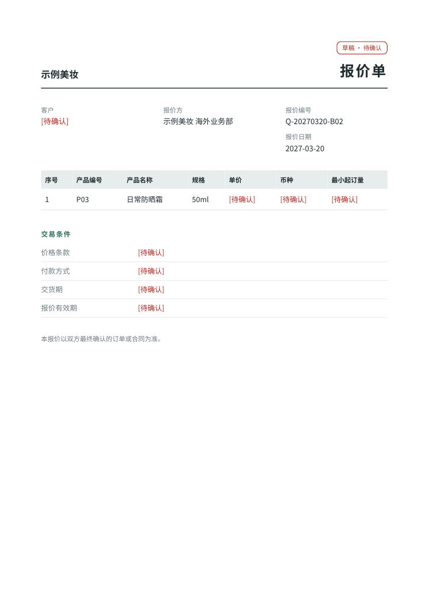

# 박람회·설명회 상담 후속 관리 에이전트

박람회, 사업설명회, 바이어 미팅이 끝난 뒤 흩어진 상담 메모를 정리해 주는 Claude 에이전트입니다.
메모를 넣으면 **바이어 관리표**(제품별 관심도 포함), 바이어별 **후속 메일·위챗 초안**(중국어·영어·한국어), **상담 결과 보고서**가 나옵니다.
제품 정보를 함께 넣으면 바이어에게 보낼 **제품 소개서 PDF(중문·영문)**와 **견적서 초안**까지 만들고, 진행 상황을 말하면 관리표를 갱신합니다.

해외영업 · 사업개발 · 트레이드 마케팅 · 글로벌 마케팅에서 행사 뒤 후속 연락을 챙기는 사람을 위해 만들었습니다.

## 한눈에 보기

- **하는 일:** 행사 상담 메모를 바이어 관리표 · 다국어 후속 연락 초안 · 상담 결과 보고서 · 제품 소개서 · 견적서 초안으로 정리합니다.
- **준비물:** Claude 데스크톱 앱(폴더 연결), Python 패키지 `openpyxl` · `weasyprint` (없으면 Claude가 설치)
- **넣을 자료:** `내자료/`에 행사정보 · 제품목록 · 상담메모 (선택: 제품상세 · 가격표 · 디자인설정)
- **시키는 말:** "내자료 폴더로 상담 후속 정리해 줘"
- **결과가 쌓이는 곳:** `결과/날짜_행사명/` (미리 만들어 둔 예시는 `예제/결과/`)

## 넣는 것 → 나오는 것

| 넣는 것 (`내자료/`) | 나오는 것 (`결과/날짜_행사명/`) |
|---|---|
| `행사정보.md` — 행사명 · 기간 · 우리 브랜드 · 서명 · 후속 기한 | `바이어관리표.csv` / `.xlsx` — 바이어별 관심 제품 · 요청 · 등급 · 다음 할 일 · 마감 · 진행 상태 |
| `제품목록.csv` — 제품명(한·중·영) · 보낼 수 있는 자료 | `바이어별_제품관심.csv` — 바이어 × 제품 관심 단계 (견적 > 샘플 > 자료 > 관심) |
| `상담메모.md` — 현장에서 적은 메모 (한·중·영 섞여도 됨) | `후속메일_초안.md` — 바이어 언어로 쓴 메일·위챗 초안 + 한국어 번역 |
| | `상담결과_보고서.md` — 등급별 요약 · 제품별 관심 · 준비할 것 · 후속 일정 · 확인 필요 |
| `제품상세.csv` (선택) — 한 줄 소개 · 용량 · 성분 · 특징 · 사용법 | `제품소개서/` — 번역 검수표 + 제품별 소개서 PDF (중문 · 영문) |
| `가격표.csv` (선택) — 단가 · MOQ · 거래 조건 | `견적서/` — 견적을 요청한 바이어별 견적서 PDF |
| `디자인설정.json` (선택) — 브랜드 색 · 글꼴 · 로고 | 소개서 · 견적서에 반영 |

## 쓰는 법

1. 이 페이지 위쪽 **Code → Download ZIP**으로 내려받아 압축을 풉니다.
2. Claude 데스크톱 앱에서 압축을 푼 폴더를 작업 폴더로 연결합니다.
3. `내자료/`에 내 파일을 넣습니다. 쓰는 법과 칸 설명은 `양식/`에 있습니다.
4. Claude에게 이렇게 말합니다.

   > 내자료 폴더로 상담 후속 정리해 줘

5. 결과는 `결과/날짜_행사명/` 폴더에 저장됩니다.

처음이라면 예제로 먼저 돌려 보세요.

> 예제 폴더로 상담 후속 정리해 줘

`예제/결과/`에 미리 만들어 둔 결과와 비교하면 어떻게 나오는지 알 수 있습니다.

## 내 브랜드에 맞추기 (디자인 설정)

제품 소개서와 견적서의 색 · 글꼴 · 로고는 설정 파일 하나로 바꿉니다.

1. `양식/디자인설정_기본.json`을 `내자료/디자인설정.json`으로 복사합니다. (처음 쓰면 Claude가 먼저 물어보고 만들어 줍니다)
2. 브랜드 색, 제품별 색, 견적서 색, 글꼴 파일, 로고 파일을 적습니다. 글꼴·로고 파일은 `내자료/`에 넣습니다.
3. 제품 하나로 소개서를 만들어 확인하고 '설정 상태'를 확정으로 바꿉니다.

- 밝은 색을 글자에 써도 읽히도록, 글자에 쓸 때는 자동으로 진하게 바꿉니다.
- 설정을 정하지 않으면 기본값(예제와 같은 모양)으로 만듭니다.

## 진행 업데이트

후속 연락을 하면서 진행 상황을 Claude에게 말하면, 이 폴더의 관리표가 바뀝니다.

> B02 중문 소개서 보냈어. 견적은 본사 확인 중  
> B04 샘플 받을 주소 받았어

- 진행 상태(할 일 · 보냄 · 회신 받음 · 끝 · 보류), 최근 업데이트 날짜, 다음 할 일 · 확인 필요가 바뀝니다.
- 바뀐 내용은 `업데이트기록.csv`에 한 줄씩 쌓이고, `바이어관리표.xlsx`도 새로 만들어집니다.
- 관리표는 Claude를 실행한 컴퓨터의 이 폴더에서만 바뀝니다. 다른 사람의 컴퓨터로 자동으로 옮겨지지 않습니다.
- 팀과 나눌 때는 담당자가 업데이트한 `바이어관리표.xlsx`를 공유합니다. 팀원은 **후속 일정 · 확인 필요 · 업데이트 기록** 시트만 보면 지금 어디까지 왔는지 알 수 있습니다.
- 실제 바이어 자료는 GitHub에 올리지 않습니다 (`내자료/`, `결과/`는 `.gitignore`로 제외).

**예제로 해 본 진행 업데이트 (가상)**

행사가 끝난 뒤 팀원이 이렇게 말했다고 가정하고 예제 관리표에 반영해 두었습니다.

> B02 중문 브랜드 소개서 보냈어. 공급가·MOQ는 본사 확인 중 → B02 `할 일 → 보냄`  
> B04 위챗으로 샘플 받을 주소 받았어 → B04 `할 일 → 회신 받음` (주소는 관리표에 적지 않음)  
> B05는 연락처가 없으니 일단 보류 → B05 `할 일 → 보류`

결과: [`예제/결과/업데이트기록.csv`](예제/결과/업데이트기록.csv) · 엑셀 [`바이어관리표.xlsx`](예제/결과/바이어관리표.xlsx)의 '업데이트 기록' 시트

## 제품 소개서 · 견적서

**제품 소개서 (중문 · 영문)**
- `제품상세.csv`에 한국어로 제품 정보를 적으면, Claude가 중국어·영어로 옮겨 `번역_검수표.csv`를 만들고 제품 하나당 한 장짜리 PDF를 만듭니다.
- 사람이 검수표의 '검수' 칸에 `OK`를 써야 정식본이 됩니다. 그 전에는 `草稿 · 待审核` / `DRAFT` 표시가 붙습니다.
- 바이어가 자료를 요청했는데 그 언어의 카탈로그가 없으면, 후속 메일 첨부 후보로 들어갑니다.
- 사진을 넣고 싶으면 `내자료/사진/P01.png`처럼 제품 코드로 이름을 붙여 둡니다. 사진이 없으면 용기 모양 그림이 들어가고, 주요 성분은 층 그림으로 보여 줍니다.
- 사진을 어떻게 찍을지는 [제품 사진 촬영 가이드](양식/제품사진_촬영가이드.md)에 정리했습니다. 소개서용 대표컷, 제형·사용 장면·시즌 무드·성분 강조 컷, AI 시안 프롬프트 틀이 있습니다.

**견적서**
- 상담에서 가격·MOQ를 물어본 바이어에게만 만듭니다.
- 단가 · MOQ · 거래 조건은 `가격표.csv`에 적힌 값만 들어갑니다. 비어 있으면 `[待确认]` / `[TBC]`로 남고 `草稿` / `DRAFT` 표시가 붙습니다.
- 값이 정해지면 가격표를 채우거나 Claude에게 말하고 다시 만들면 됩니다.

## 결과 예시 (모두 가상 자료)

| 제품 소개서 (중문) | 제품 소개서 (영문) | 견적서 초안 |
|---|---|---|
|  |  |  |

- [바이어 관리표 (엑셀)](예제/결과/바이어관리표.xlsx) · [CSV](예제/결과/바이어관리표.csv)
- [바이어별 제품 관심](예제/결과/바이어별_제품관심.csv)
- [진행 업데이트 기록](예제/결과/업데이트기록.csv)
- [후속 메일·위챗 초안](예제/결과/후속메일_초안.md)
- [상담 결과 보고서](예제/결과/상담결과_보고서.md)
- [제품 소개서 PDF와 번역 검수표](예제/결과/제품소개서/)
- [견적서 초안](예제/결과/견적서/)

예제 견적서는 금액을 비워 둔 상태입니다. 가격표를 채우지 않으면 이렇게 나온다는 것을 보여 주려고 그대로 두었습니다.

## 이 에이전트가 지키는 것

- 메모에 없는 내용은 쓰지 않습니다. 애매하거나 빠진 것은 **확인 필요**로 표시합니다.
- 가격 · 최소 주문량 · 독점 · 납기 · 인증처럼 약속이 되는 조건은 지어내지 않습니다. `[담당 확인 후 기입]` 자리만 남깁니다. 견적서도 마찬가지입니다.
- 제품 소개서 번역은 원문에 있는 내용만 옮깁니다. 효능을 키우거나 인증을 더하지 않고, 사람이 검수하기 전에는 초안으로 둡니다.
- 첨부는 제품목록의 '보낼 수 있는 자료'와 이번에 만든 제품 소개서·견적서에 있는 것만 적습니다.
- 메일은 보내지 않습니다. 초안까지만 만들고, 보내는 것은 사람이 합니다.

## 필요한 것

- Claude 데스크톱 앱 (폴더 연결)
- PDF·엑셀을 만들 때 Python 패키지 `weasyprint`, `openpyxl` — 없으면 Claude가 설치합니다 (`pip install weasyprint openpyxl`).

## 주의

- 실제 바이어 정보와 가격은 내 컴퓨터의 `내자료/`에만 둡니다. 이 저장소에 올리지 마세요. (`.gitignore`에 `내자료/`와 `결과/`가 들어 있습니다)
- `예제/`의 브랜드, 박람회, 바이어, 제품 정보는 모두 가상입니다.
- `SKILL.md`는 Claude 스킬 형식이라 스킬로 추가해서 써도 됩니다.

## 폴더

```
gbsa-trade-show-followup-agent/
├── README.md        ← 이 안내
├── CLAUDE.md        ← 폴더를 연결하면 Claude가 먼저 읽는 파일
├── SKILL.md         ← 작업 규칙 (스킬)
├── 도구/            ← 제품 소개서(그림 포함) · 견적서 PDF, 팀 공유 엑셀을 만드는 스크립트
├── 양식/            ← 입력 파일 쓰는 법, 칸 설명, 제품 사진 촬영 가이드, 디자인 설정 기본값
├── 예제/
│   ├── 입력/        ← 가상 행사 · 제품 · 상담 메모 8건 · 제품상세 · 가격표(빈칸)
│   └── 결과/        ← 예제로 돌린 결과 (미리보기 이미지 포함)
└── 내자료/          ← 내 파일을 넣는 곳 (저장소에는 비어 있음)
```
